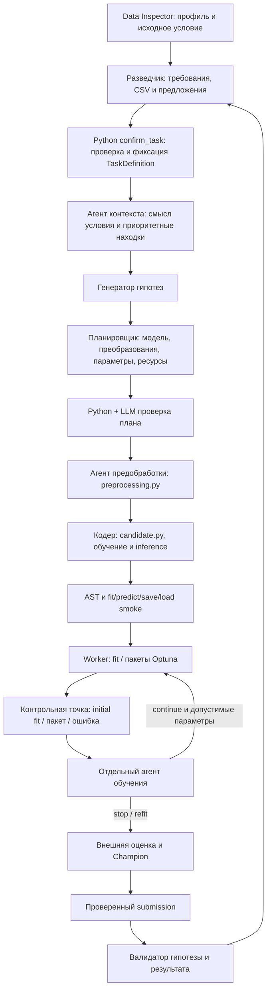

# Агенты и контроль обучения

Первый цикл по умолчанию сравнивает LightGBM, CatBoost и XGBoost параллельно в пределах
общего CPU/RAM. В каждом цикле работает роль `feature_agent`: в первом после стартовой
партии бустингов и выбора/HPO победителя, затем после выбора моделей текущего раунда
на новом train-split. При отключённом `initial_boosting_sweep` прежний одиночный
baseline запускает feature search после первого submission перед HPO.
Она координирует DSL-признаки, Planner оформляет парную проверку, а SDK и worker
вычисляют признаки и доказательства. Контракты, isolation, resume и критерии принятия:
[FEATURE_AGENT_RU.md](FEATURE_AGENT_RU.md).

Семейства моделей и отдельная роль `ensemble_agent` описаны в
[SEARCH_GROUPS_RU.md](SEARCH_GROUPS_RU.md). Planner оформляет группы поиска,
кодеры реализуют варианты, workers используют общий admission ресурсов.

Контракт v2 после lifecycle-аудита: [MODEL_CONTRACT_V2_RU.md](MODEL_CONTRACT_V2_RU.md).
Он уточняет владение target/weight/output policies, fit-time provenance,
передачу CV-метрик, CodePatch и режимы thinking в новых запусках.

После аудита 22.10 runtime проверяет фактическое исполнение и полный export/recreate
до внешней оценки, Champion и публикации. Advisory result_validator не может отменить
отказ machine gate. Контракты и доказательства:
[исправления аудита](AUDIT_CONTRACT_FIXES_20261022_RU.md).

Жёсткие таймауты отключены по умолчанию (`timeouts_enabled=false`). Все указанные ниже окна в секундах применяются только при явном включении таймаутов; CPU/RAM, схемы, число попыток/trials, изоляция фолдов и обязательный refit действуют всегда. Ансамбли разрешены с OOF-обучением meta-model и переносимым сохранением компонентов.

## Восстановление планирования после ошибок

Пояснения отделены от исполняемых настроек через `agent_notes`: дополнительные
reasoning, rationale, notes, assumptions и другие поддерживаемые описательные поля
сохраняются и передаются следующим ролям. Неизвестные настройки исполнения остаются
ошибками. Однозначные варианты оформления (один план без обёртки plans, строка
preprocessing, известные синонимы change_kind) нормализуются без повторного LLM-вызова.
Лимит длины пояснения — предел отображаемого поля: полный текст сохраняется в
agent_notes. Контекстный агент может вернуть больше 24 находок; ссылки на реальные
факты, цитаты исходного условия и обязательные critical-находки проверяются по-прежнему.

Абляция, меняющая только политику, наследует сохранённое описание и исходник
предобработки; агенту не требуется дословно воспроизводить текст. Новая формулировка
сохраняется как пояснение. Если заявлены изменения нескольких групп или собственного
кода, план допускается как обычный эксперимент без утверждения об эффекте одной
замены. Проверки исходников, изоляции данных, fit/export и CSV остаются обязательными.
Фиксированный CPU-device допустим; GPU и поиск по инфраструктурным параметрам запрещены.

Отказы конкретной гипотезы и backend записываются в planning_progress.rejections.
Две одинаковые ошибки подряд или max_attempts отвергнутых планов суммарно откладывают
эту гипотезу. Внешний повтор запрашивает новые идеи с историей отказов; переименование
той же гипотезы не сбрасывает счётчик. Resume сохраняет историю. Отказ одного backend
семейства не блокирует другие. Временный отказ API не считается опровержением гипотезы;
готовый план сохраняется для повторной проверки.

Даже в continuous-режиме число внешних попыток планирования в одном цикле ограничено
max_attempts (по умолчанию 3). После исчерпания попыток выполняется финализация с
лучшим доступным результатом. Успешные планы и CSV не удаляются. Число успешных
циклов по-прежнему не ограничивается, если max_rounds и plateau_rounds не заданы.
Проверки исторических отказов: `tests/test_planning_resilience.py`.

Жизнь родительского процесса в Linux проверяется по kernel start ticks, без
сравнения epoch timestamps. `parent_exit` останавливает pipeline как инфраструктурный
отказ, сохраняя CSV; агенты не получают задание переписывать модель. Подробности:
[контроль workers](WORKER_SUPERVISION_RU.md).

Планировщик остаётся источником задания для кодеров. Агент обучения — отдельная роль четвёртого этапа, не кодер и не замена планировщику.

## Границы компонентов

После каждого цикла отдельный worker выполняет полный fixed refit победителя на
всех размеченных строках и сохраняет CSV. Его роль `submission_refit` запрещена в
Champion, сравнении вариантов и пуле ансамблей. Сравнительная модель продолжает
жить отдельно; подробности и режим внешней остановки:
[CYCLE_FULL_REFIT_RU.md](CYCLE_FULL_REFIT_RU.md).

preprocessing_agent пишет только preprocessing.py и описание выхода. coding_agent пишет модель и не может изменять этот модуль. SDK PreparedCandidate передаёт модельному коду преобразованные X и validation_X. Для каждого fit создаются новые объекты. Преобразования обучаются только на текущем train; target encoding должен выдавать OOF-значения с учётом групп. SDK проверяет число строк; статистическая корректность дополнительно проверяется инструкциями и тестами. Это не песочница для произвольного вредоносного Python.

Артефакт содержит estimator/, preprocessing.pkl и prepared-config.pkl. Native-файлы сохраняются внутри estimator/. Старые кандидаты без preprocessing.py используют прежний SDK. preprocessing_hash хранится в CandidateVersion, полный code_hash покрывает все Python-модули.

Planner получает technique_skills: метаданные совместимых скилов предобработки и imbalance.
Выбранные ID из plan.skill_ids загружаются исполняющей роли; базовый preprocessing_core
подключается автоматически. Sampling и преобразование y принадлежат кодеру модели,
preprocessing.py сохраняет строки. Детали — в docs/SKILLS.md.

## Контроль обучения

training_agent получает TrainingCheckpoint с планом, внутренними метриками, параметрами, ошибками и остатком бюджета. Метки внешнего holdout и LLM-ключи не передаются worker. Агент вызывается после первого fit, после пакета Optuna и при ошибке; на отдельных итерациях boosting он не вызывается. Native AutoML остаётся внутри библиотеки: точки контроля — завершение native fit или ошибка.

TrainingDecision задаёт continue, stop или refit. stop и refit заканчивают поиск; затем обязательное обучение выбранной конфигурации на всём train текущего цикла. Без времени на refit эксперимент не допускается к внешней оценке. До пяти next_params задают будущие trials внутри утверждённого пространства. Изменения модели или пространства — только рекомендации следующему циклу. После initial single fit продолжать поиск нельзя: сначала сохраняется первый submission, затем оркестратор запускает HPO.

По умолчанию пакет — пять trials, максимум — 15 trials / 600 секунд. Программная политика продолжает после относительного улучшения не менее 0,5%; агент может обоснованно продолжить после plateau, сохраняя исходные временные и trial-лимиты. Значения, типы и границы предложений проверяются в контроллере и worker.

При включённых таймаутах запрос ограничен training_control_seconds; ожидание входит в worker/HPO бюджет. Таймаут или неверный ответ использует программную политику. Checkpoint, pending_control, study, sampler и решения сохраняются. Атомарный mailbox выбирает единственный ответ, включая гонку с таймаутом; resume повторно использует решение и исходный дедлайн.

## Разведка и проверка результата

Начальный отчёт использует train. После цикла добавляются агрегаты ошибок по хвостам цели, пропускам, редким категориям, дублям и подозрительным значениям. Границы хвостов — q01/q99 обучающей части; редкая категория имеет поддержку меньше max(20, ceil(1% train)). Срезы до 20 строк помечаются insufficient_support. Неприменимые оценки не выдумываются.

Численные наблюдения создаёт Python. Начальная разведка заменяет отдельного постановщика:
LLM читает исходное условие и профиль, подтверждает TaskDefinition через confirm_task,
затем исследует зарегистрированные CSV. Инструменты: read_task, list_tables, preview_csv,
query_csv, correlate_csv и save_observation. SQL — Polars 1.26.0 SELECT/WITH; DuckDB не используется.
Схемы выдаются страницами по 20 колонок. Расчёты выполняются в Scheduler worker до 30 секунд;
агрегат может охватить всю таблицу, ответ ограничен 100 строками, 20 колонками и 32 000 символов.
Полные результаты сохраняются в Parquet, CP1251 читается pandas порциями с атомарным кешем.
Test содержит признаки без ответов; sample_submission предоставляет только схему, его значения — заглушки.
Уточнения получают train-часть завершённого раунда, а метки holdout доступны только через агрегаты.
Находки сохраняются до итогового отчёта и ссылаются на реальные результаты. Таймаут после
подтверждения требований даёт partial-отчёт; без подтверждения обучение не запускается.
Resume сохраняет исходные дедлайны, подтверждённый контракт и завершённые запросы.

result_validator оценивает implementation: matches/partial/mismatch/unknown и effect: supported/not_supported/inconclusive. Без сопоставимого reference подтверждение понижается до inconclusive. Отчёт не блокирует Champion или submission. Оценки разных внешних split не сравниваются как одна выборка.

После определения причины остановки последнего цикла advisory result_validator и
follow-up разведчик не вызываются. Если нужен следующий цикл, review сохраняется,
а разведка выполняется при подготовке его planning payload. Она использует готовый
`splits/<round>/train.csv` без второй копии train. Проверки библиотек выполняются
только для выбранных Planner backends. После успешного чтения predictions временный
вход `predictions/*/features.csv` удаляется; ошибка уборки записывается в trace и
не отменяет готовый прогноз. Выходные predictions и журналы остаются доступными.

## Артефакты и настройки

- reconnaissance/*.json — начальный и последующие отчёты;
- reviews/*.json — проверки гипотез и результатов;
- runs/*/control/ — запросы и решения контрольных точек;
- experiments.sqlite3 — preprocessing, reconnaissance, result_review, training_checkpoint, training_decision;
- trace — события ролей, скилы и решения.

Defaults: initial_reconnaissance_seconds=300, reconnaissance_seconds=120, reconnaissance_steps=20, reconnaissance_query_seconds=30, result_validation_seconds=30, training_control_seconds=30. Все ограничены общим бюджетом. Incumbent и финальный fixed refit выполняются программно с сохранёнными параметрами, без нового поиска.

## Агент контекста для Planner

После разведки context_agent получает полное исходное условие без усечения,
подтверждённый TaskDefinition, профиль и все находки начальной/текущей разведки.
Входные проблемы упорядочены по severity; агент уточняет приоритет по смыслу задачи,
ожидаемому влиянию на метрику и полезности для решений Planner.

Результат planning_brief включает task_summary, детали смысла с цитатами исходного
условия, ranked_findings с причинами и действиями, assumptions и статусы незаконченной
разведки. Обнаруженные факты отделены от предложений экспериментов. ID проверяются;
измеренные evidence добавляет Python. Все critical-находки передаются дополнительно,
даже если не вошли в выбранные находки. Основные формальные требования и эффективные
metric_options/submission_kind прикладываются без пересказа и не редактируются агентом.

Brief получают генератор гипотез, Planner и валидатор плана. Инструмент read_task
позволяет генератору гипотез и Planner уточнять полный исходный текст страницами. При ошибке/таймауте передаются
исходное условие, проверенные требования и программно ранжированные факты.

Окно context_seconds=120, максимум две попытки в общем исходном окне. Вызов не забирает
время, необходимое для допуска полноценной гипотезы. Входы, brief и бюджет сохранены
в planning_context/ и experiments.sqlite3. Повторы/альтернативы используют кеш;
новые находки меняют input_hash и обновляют brief. Resume не расширяет дедлайн.

## Проверка Python окружения

До первого LLM-запроса runtime_check worker проверяет импорты, интерпретатор,
venv и версии базовых пакетов. Сбой получает worker_runtime_error и завершает
запуск с конкретной причиной. PYTHONPATH сохраняет эффективные пути контроллера,
runtime.json фиксирует обе стороны. При resume проверка повторяется, не расширяя
бюджет. Подробности: docs/WORKER_RUNTIME.md.

## Уточнения контрактов после ревью 22 октября 2026

По умолчанию timeouts_enabled=false; временные окна действуют при явном включении.
Ограниченные diagnostic/replay entrypoints включают их явно. Старые session без флага
восстанавливаются с прежней политикой true; явно менять её при resume нельзя.
Прогнозы worker передаются через Parquet с сохранением типов меток.
Multilabel log_loss — средняя binary cross entropy по меткам с весами строк.
Multilabel stratified_kfold отклоняется при подтверждении; используйте holdout или group_kfold.
Ансамбли разрешены, но native AutoML-компоненты пока отклоняются до проверки frozen refit.
Для stacking с отдельной предобработкой обязателен fit_stack(X,y,context,create_preprocessor):
он получает исходный X. Каждая база оборачивается PreparedCandidate с собственной
предобработкой внутри OOF-фолда и при полном refit. predict получает исходные признаки;
сохранение включает обёрнутые базы и метамодель. Прежний estimator-only fit остаётся
путём обычных кандидатов и blending. Это уточнение заменяет прежние запреты ансамблей
и утверждения об обязательности временных лимитов в этом документе.
