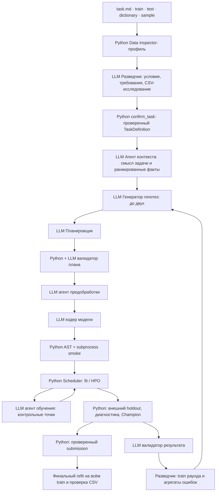

# Как сейчас работает MLmom

Схема обновлена 22 октября 2026 года. Основной проект запускается через solution.py.
Отдельная LLM-роль постановки удалена: требования подтверждает разведчик инструментом confirm_task.

## Разведка

Начальное окно — 300 секунд, последующие — 120, включая инструменты и исправления.
Разведчик сначала подтверждает target, метрику/options/direction, ID, исключения,
validation strategy и формат результата. Python TaskValidator сохраняет проверенный
контракт сразу; позднее менять его нельзя. Отдельного постановщика нет.

Инструменты: read_task, list_tables, preview_csv, query_csv, correlate_csv,
confirm_task, save_observation. Используются только разрешённые Polars 1.26.0,
pandas и стандартная библиотека. SQL SELECT/WITH работает по зарегистрированным
ленивым таблицам; CORR отсутствует в SQL этой версии, поэтому корреляции выполняет
отдельный инструмент. Нельзя читать произвольные пути или выполнять SQL-запись.

Каждый расчёт проходит Scheduler, занимает до 30 секунд и ограничен CPU/RAM.
LLM получает до 100 строк, 20 колонок и 32 000 символов; полный результат — Parquet.
Большие агрегаты могут просматривать всю таблицу. CP1251 преобразуется порциями
через pandas с атомарной публикацией кеша. Ошибочные строки не пропускаются молча.

Test содержит признаки без ответов; sample_submission доступен только как схема,
его значения не участвуют в анализе. Повторная разведка видит обучающую часть
завершённого раунда, а внешний holdout — только в виде агрегированных результатов.
До создания первого split начальная разведка, как и Inspector, видит исходный train.

При таймауте после подтверждения используется partial-отчёт с уже сохранёнными
находками. Без проверенной постановки обучение запрещено. Resume сохраняет
исходные окна, требования, профиль и завершённые расчёты. Незаконченные проверки
передаются следующему вызову разведчика.

## Контекст для планирования

Отдельный context_agent читает полное исходное условие, проверенную постановку,
профиль и факты разведчика. Он сохраняет смысл задачи и ранжирует особенности данных
по их значению для Planner. Формальные требования прикладывает Python без пересказа.
Детали смысла подкрепляются цитатами; находки — ID и неизменными измеренными evidence.
Critical-находки не теряются при сжатии. Гипотезы, Planner и валидатор получают один brief.

Default context_seconds=120; повторы и resume используют исходное окно. При сбое
Planner получает полный текст и программную сводку. read_task доступен для уточнений.

## Остальной цикл

До первого CSV обязателен простой baseline: single, один trial, до 300 секунд,
без native AutoML, медленных backend и ансамблей. После валидного CSV разрешён
HPO baseline, затем альтернатива. Кодирование предобработки, модели и smoke делят
исходное окно до 300 секунд; runtime repair и resume его не обнуляют.

Каждый раунд по умолчанию меняет holdout seed: 42, 43 и далее. Incumbent обучается
с прежними параметрами и сравнивается с кандидатами на том же внешнем holdout.
Старые score разных split не являются порогом продвижения. При сбое переоценки
incumbent исторический Champion сохраняется. Независимого audit holdout нет.

HPO использует только внутреннюю validation: до 15 trials, пакетами по пять,
до 600 секунд и внутри worker-бюджета. Программный порог продолжения — 0,5%
относительного улучшения; training_agent может продолжить после plateau,
но не расширяет исходные лимиты. Контрольная точка — до 30 секунд.

Общий запуск — 180 минут, резерв финализации — минимум 40 минут, до трёх workers.
Остановка — бюджет, max_rounds, plateau или заданная цель завершённых циклов.
Финальный refit использует весь train и сохранённые параметры без нового HPO.
При его сбое сохраняется последний корректный CSV.

## Навигация

- Контракты ролей и обучения: [AGENT_ROLES.md](AGENT_ROLES.md).
- Ограничения и владельцы инструкций: [SKILLS.md](SKILLS.md).
- Полный жизненный цикл: [LIFECYCLE.md](LIFECYCLE.md).
- Архитектура компонентов: [ARCHITECTURE.md](../ARCHITECTURE.md).
- Основная реализация разведки: research.py и csv_tools.py; подтверждение — TaskValidator.

Документ описывает код. Проверка с подставным LLM не доказывает качество рассуждений
реальной модели; платные LLM-запуски при этом изменении не выполнялись.

## Уточнения контрактов после ревью 22 октября 2026

По умолчанию timeouts_enabled=false; временные окна действуют при явном включении.
Ограниченные diagnostic/replay entrypoints включают их явно. Старые session без флага
восстанавливаются с прежней политикой true; явно менять её при resume нельзя.
Прогнозы worker передаются через Parquet с сохранением типов меток.
Multilabel log_loss — средняя binary cross entropy по меткам с весами строк.
Multilabel stratified_kfold отклоняется при подтверждении; используйте holdout или group_kfold.
Ансамбли разрешены, но native AutoML-компоненты пока отклоняются до проверки frozen refit.
Для stacking с отдельной предобработкой обязателен fit_stack(X,y,context,create_preprocessor):
он получает исходный X. Каждая база оборачивается PreparedCandidate с собственной
предобработкой внутри OOF-фолда и при полном refit. predict получает исходные признаки;
сохранение включает обёрнутые базы и метамодель. Прежний estimator-only fit остаётся
путём обычных кандидатов и blending. Это уточнение заменяет прежние запреты ансамблей
и утверждения об обязательности временных лимитов в этом документе.
