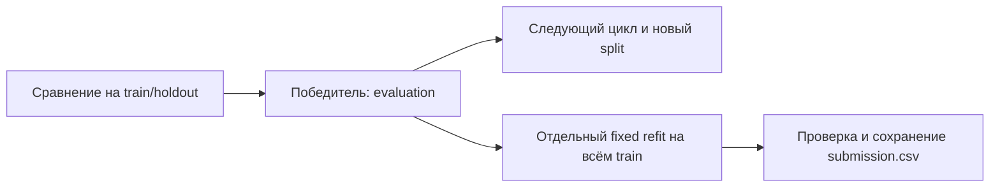

> Актуальный runtime v3: [агентский пайплайн](AGENT_PIPELINE_V3_RU.md). Описание ниже сохраняет предыдущий контракт для истории.

# Полный refit и непрерывный запуск

Новые запуски по умолчанию используют `cycle_full_refit=true`. После сравнения
моделей и feature search цикл фиксирует победителя, его исходники, предобработку,
параметры и политики. Отдельный worker заново обучает эту конфигурацию на исходном
train.csv целиком. Внешний holdout для этого обучения не выделяется; test.csv остаётся
входом для предсказаний. Нового HPO, выбора признаков или выбора состава ансамбля нет.
Обучаемые части выбранного ансамбля используют его зафиксированный протокол внутренних
OOF; итоговые базы обучаются на всех размеченных строках без внешнего holdout.

## Изоляция

- Сравнительный победитель остаётся `Champion` с `run.role=evaluation` и настоящей
  внешней метрикой. Именно его код и параметры переобучаются на train следующего цикла.
- Полная модель имеет `role=submission_refit`, `split_id=all-train`, пустые trials
  и отсутствующие internal/holdout scores. У неё отдельный каталог модели.
- Полные модели циклов сохраняются в `submission_refit`, а не в `experiment`.
  `Champion`, внутреннее ранжирование, регистрация компонентов и пул ансамблей
  дополнительно отклоняют эту роль. Полная модель не становится контрольной
  моделью и не используется для обучения/подбора новых вариантов.
- `submission_refit_source` связывает полный refit с точным сравнительным
  экспериментом, хешами кода/конфигурации/датасета и числом train-строк.
  `submission_champion` хранит его исходную сравнительную модель и её метрику.

## Сохранение

В каждом цикле, в том числе без смены конфигурации победителя, выполняется новый
полный fit. Каталоги:

| Файл | Содержание |
|---|---|
| `runs/rN-submission-refit/` | Модель, запрос обучения, исполнение и логи |
| `cycles/rN/submission.csv` | Неизменяемый ответ цикла |
| `cycles/rN/submission.json` | Источник CSV, SHA-256, формат, ID и значения |
| `cycles/rN/refit.json` | Статус полного refit и исходный победитель |
| Рядом с `task.md`: `submission.csv` | Последний готовый ответ |

CSV проходит проверку схемы организаторов, числа строк, порядка ID, отсутствия
пропусков, конечности чисел/допустимых классов. Замена текущего файла атомарна.
После первого полного refit промежуточные evaluation-модели следующего цикла не
перезаписывают его. Если следующий полный fit не удался, прежний полный CSV остаётся;
новый цикл отмечается неполным, а его `refit.json` содержит ошибку. Первый быстрый
baseline до готовности первого полного refit может дать предварительный CSV.
Успешные сравнительные модели такого цикла остаются доступными для ансамблей:
`evaluation_completed` учитывается независимо от результата submission-refit.

Resume повторно использует завершённый полный fit и проверяет неизменность источника.
Успешный refit последнего цикла не повторяется ещё раз при штатной финализации.
Старые session без `cycle_full_refit` сохраняют прежнюю политику при resume.

## Внешняя остановка

Стандартная конфигурация: `timeouts_enabled=false`, `max_rounds=null`,
`plateau_rounds=null`, `target_completed_rounds=0`. Плато trials заканчивает только
локальный поиск. Повторяемые ошибки планирования не исчерпывают общий счётчик попыток;
LangGraph сохраняет checkpoint после planning и analysis, поэтому накопленное число
циклов/повторов не упирается в лимит шагов одного вызова.

`SIGTERM` и Ctrl+C завершают выполнение без нового долгого refit, сохраняют отчёт
`external_stop` и закрывают workers. Уже готовый полный CSV остаётся на диске.
Жёсткая остановка не требует финального обучения: ответы завершённых циклов уже
сохранены. Ошибки доступа к API и инфраструктуры остаются явными причинами отказа.

Часовой Docker-контроллер ограничивает задачу снаружи, затем независимо проверяет
последний CSV и повторный inference. Для диагностических прогонов можно явно вернуть
внутренние ограничения времени, числа циклов и plateau.

## Проверки

Тесты проверяют полный fit всех 180 размеченных строк против 144 строк сравнительного
обучения, отдельные модели/метрики, CSV для регрессии и классификации, resume,
сохранение ответа при SIGTERM и при ошибке следующего полного fit. Дополнительные
проверки проходят 120 циклов и 150 повторов planning без накопленного лимита шагов.
