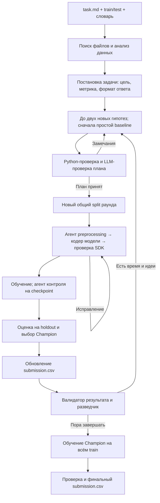

# Жизненный цикл задачи MLmom

Разделение ролей и протокол checkpoint подробно описаны в [AGENT_ROLES.md](AGENT_ROLES.md).

В каждом цикле выполняется отдельная [feature-сессия](FEATURE_AGENT_RU.md):
до шести конфигураций на фиксированной модели, парная внутренняя CV и одна внешняя
проверка выбранного набора. В первом цикле она идёт между первым submission и HPO;
в следующих — после выбора моделей текущего раунда. Принятые признаки сохраняются,
новые train/folds и бюджет сессии создаются заново. При отказе сохраняется Champion.

## Общая схема

## 1. Запуск

`python solution.py task.md` запускает весь процесс одной задачи, включая анализ данных и постановку. Платформа передаёт подключение к LLM через окружение; общий боевой срок составляет 180 минут, резерв финального обучения — минимум 40 минут.

## 2. Поиск и анализ данных

Агент находит train, test, словари и условие, включая случаи с устаревшими путями в тексте задания. Data Inspector анализирует train и словари: типы колонок, пропуски, распределения, дубликаты, служебные поля и возможные риски.

## 3. Постановка задачи

Разведчик в начальном окне 300 секунд формирует проверяемый контракт: что предсказывать, какую метрику улучшать и какие колонки записать в ответ. Python проверяет этот контракт и возвращает ошибки на исправление; без корректной постановки обучение не начинается.

## 4. Гипотезы, скиллы и планы

LLM предлагает до двух новых подходов за раунд, включая быстрый baseline в первом; Planner выбирает библиотеку, обработку признаков, параметры и бюджет. Вначале разрешены одиночные модели без HPO, AutoML и ансамблей, с обучением до 300 секунд. Сложные планы доступны со второго раунда после корректного submission и при достаточном бюджете. Каждая роль получает только собственные и необходимые общие инструкции; чужие скилы недоступны через read_skills.

## 5. Проверка планов

Python проверяет доступность библиотек, метрики, скиллы, параметры, ресурсы и ограничения простого старта, затем LLM проверяет методологию. Планы исправляются независимо: ошибка альтернативы не отменяет принятый baseline. Тяжёлые библиотеки проверяются по запросу выбранного сложного плана, чтобы не задерживать первый ответ.

## 6. Разбиение данных

Для каждого раунда создаётся новый внешний train/holdout, одинаковый для всех его кандидатов; учитываются подтверждённые группы и тип задачи. Внутренняя валидация для HPO и early stopping строится только внутри train текущего раунда.

## 7. Код кандидата

Агент предобработки пишет отдельный preprocessing.py; Coding Agent пишет модель по заданию планировщика и описанию преобразованных признаков. SDK создаёт новый preprocessing для каждого fit и сохраняет его с моделью; baseline всегда проходит тот же LLM-кодер. Проверяются синтаксис, импорты, fit/predict/save/load и переносимость модели; ошибки возвращаются кодеру. Общий лимит до 300 секунд на код, инструменты, smoke и исправления одной гипотезы сохраняется между попытками, runtime repair и resume.

## 8. Обучение

Scheduler допускает совместимые задания в отдельные процессы с учётом занятых CPU/RAM и дедлайна, максимум по три одновременно. Единый admission применяется ко всем worker-запускам, включая probe, smoke и predict. Когда открыт сложный режим, обычные модели используют общий Optuna runner при запросе HPO, AutoML-библиотеки — разрешённый собственный поиск.

После initial fit, пакетов Optuna и ошибок отдельный training_agent принимает continue/stop/refit и может предложить параметры будущих trials в пределах плана. Запрос занимает до 30 секунд из существующего бюджета. При сбое действует программная политика.

## 9. Оценка и Champion

Worker возвращает предсказания, а инфраструктура считает метрику на внешнем holdout и выбирает лучшую модель. Предыдущий Champion переобучается на том же split без нового HPO; результаты разных split напрямую не сравниваются.

## 10. Ранний ответ и следующий раунд

В первом раунде baseline кодируется, обучается и оценивается до подготовки альтернативы из той же партии гипотез. После выбора Champion агент предсказывает test и атомарно обновляет `submission.csv`, сохраняя предыдущий корректный файл при сбое. В следующий раунд передаются лучшие сопоставимые результаты, агрегированные ошибки и failures; цикл повторяется, пока хватает бюджета и есть улучшения.

## 11. Финализация

При достижении финального резерва новые исследования прекращаются, а выбранная конфигурация обучается на всём train без нового поиска. Резерв начинается с 40 минут и может увеличиваться по результатам обучения. После проверки ID, порядка строк, колонок и предсказаний финальный файл заменяет исследовательский submission; при неудачном refit сохраняется последний корректный ответ.

## 12. История и восстановление

В каталоге запуска сохраняются постановка, планы, версии кода, скиллы и их хеши, split, модели, trials, метрики и логи. Полные запросы/ответы API, вызовы инструментов, тексты скиллов и события Scheduler доступны в `trace.jsonl`, `trace_payloads/` и итоговом `trace.md`; [TRACING.md](TRACING.md) объясняет связи и очистку секретов. `--resume` продолжает тот же запуск по SQLite/checkpoints, проверяет входные файлы и сохраняет исходные дедлайны запуска и кодирования.

## 13. Разделение ответственности

LLM предлагает идеи, планы и полный код кандидата; скиллы дают инструкции и справочные примеры. Сгенерированный код напрямую вызывает ML-библиотеки. Разбиение, ресурсы, метрики, Champion и итоговый файл контролирует инфраструктура.

Разведчик также исследует CSV через Polars SQL и correlate_csv. Уточнения получают 120 секунд, каждый расчёт — до 30. Отчёты partial сохраняют проверенный контракт и находки при таймауте. Подробнее: [AGENT_ROLES.md](AGENT_ROLES.md).

Перед планированием context_agent получает полное условие и факты разведчика, создаёт task-grounded planning_brief. Канонические требования сохраняются без сжатия, исходный текст доступен через read_task.
