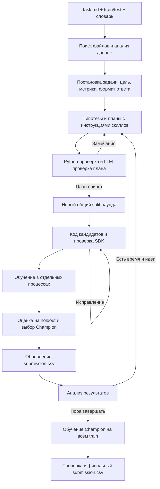

# Жизненный цикл задачи MLmom

## Общая схема

## 1. Запуск

`python solution.py task.md` запускает весь процесс, включая анализ данных и постановку задачи. Платформа передаёт подключение к LLM через окружение; общий боевой срок составляет 180 минут.

## 2. Поиск и анализ данных

Агент находит train, test, словари и условие, включая случаи с устаревшими путями в тексте задания. Data Inspector анализирует train и словари: типы колонок, пропуски, распределения, дубликаты, служебные поля и возможные риски.

## 3. Постановка задачи

LLM формирует проверяемый контракт: что предсказывать, какую метрику улучшать и какие колонки записать в ответ. Python проверяет этот контракт и возвращает ошибки на исправление; без корректной постановки обучение не начинается.

## 4. Гипотезы, скиллы и планы

LLM предлагает до трёх подходов, включая быстрый baseline, а Planner выбирает библиотеку, обработку признаков, параметры и бюджет. Базовые инструкции подключаются автоматически, выбранные библиотечные и технические скиллы доступны через read_skills и передаются проверке плана и кодеру.

## 5. Проверка планов

Python проверяет доступность библиотек, метрики, скиллы, параметры и ресурсы, затем LLM проверяет методологию. Некорректный план отправляется на исправление в пределах установленного числа попыток.

## 6. Разбиение данных

Для каждого раунда создаётся новый внешний train/holdout, одинаковый для всех его кандидатов; учитываются подтверждённые группы и тип задачи. Внутренняя валидация для HPO и early stopping строится только внутри train текущего раунда.

## 7. Код кандидата

Coding Agent пишет Python-кандидата по SDK, плану и выбранным скиллам в отдельном workspace. Проверяются синтаксис, импорты, fit/predict/save/load и переносимость сохранённой модели; ошибки возвращаются кодеру.

## 8. Обучение

Scheduler запускает совместимые задания в отдельных процессах, ограничивая CPU, память и время, максимум по три одновременно. Обычные модели используют общий Optuna runner при запросе HPO, AutoML-библиотеки — разрешённый собственный поиск.

## 9. Оценка и Champion

Worker возвращает предсказания, а инфраструктура считает метрику на внешнем holdout и выбирает лучшую модель. Предыдущий Champion переобучается на том же split без нового HPO; результаты разных split напрямую не сравниваются.

## 10. Ранний ответ и следующий раунд

После выбора Champion агент предсказывает test и атомарно обновляет `submission.csv`, сохраняя предыдущий корректный файл при сбое. В следующий раунд передаются лучшие сопоставимые результаты, агрегированные ошибки и failures; цикл повторяется, пока хватает бюджета и есть улучшения.

## 11. Финализация

Около 40 минут до общего дедлайна новые исследования прекращаются, а выбранная конфигурация обучается на всём train без нового поиска. После проверки ID, порядка строк, колонок и предсказаний финальный файл заменяет исследовательский submission; при неудачном refit сохраняется последний корректный ответ.

## 12. История и восстановление

В каталоге запуска сохраняются постановка, планы, версии кода, скиллы и их хеши, split, модели, trials, метрики и логи. `--resume` продолжает тот же запуск по SQLite/checkpoints, проверяет входные файлы и сохраняет исходный дедлайн.

## 13. Разделение ответственности

LLM предлагает идеи, планы и код; скиллы дают инструкции, а адаптеры и Python-инструменты выполняют работу. Разбиение, ресурсы, метрики, Champion и итоговый файл контролирует инфраструктура.
